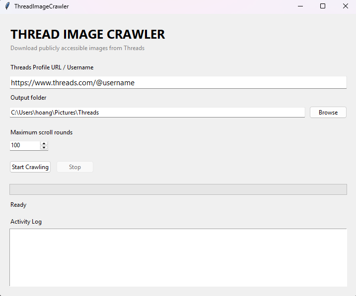
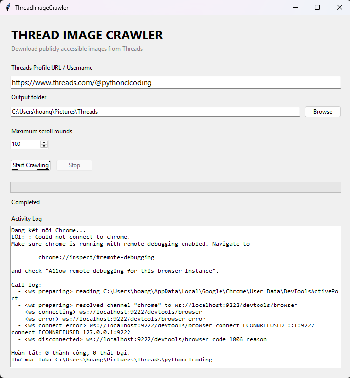
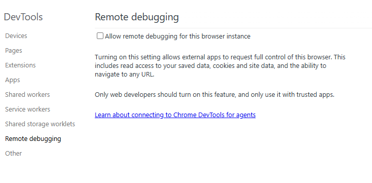
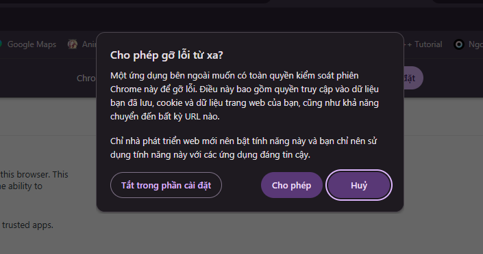
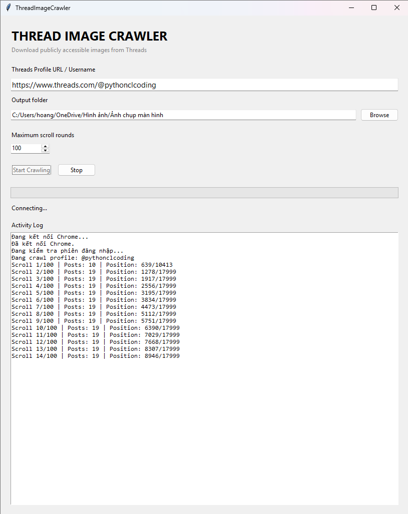
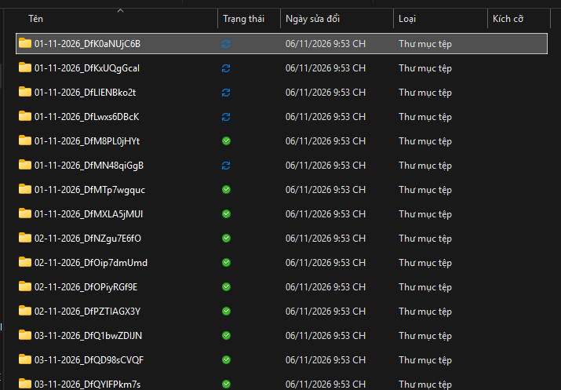

# Cách sử dụng ứng dụng tải ảnh trên thread

## Lưu ý: ứng dụng chỉ tải ảnh, nếu trong tương lai còn phát triển thì sẽ có thêm tính năng tải ảnh và bài viết

> Mở ứng dụng như bình thường, khi mở giao diện sẽ như này

> 

Đầu tiên sẽ là gán link, ví dụ: [https://www.threads.com/@pythonclcoding](https://www.threads.com/@pythonclcoding), scroll tương đương với 1 bài post, tối đa 500, nhưng mọi người có thể tắt nó trong code:))

sau đó nhấn start

> ## Nếu nó phát sinh ra lỗi như này
>
> 

> Copy dòng chrome://inspect/#remote-debugging đưa lên chrome, 

Nhấn tích dòng "Allow remote debugging for this browser instance" hay "Cho phép gỡ lỗi từ xa đối với phiên bản trình duyệt này", rồi quay lại chương trình

Điều lưu, khi đã bấm chọn dòng Allow.. và bắt đầu start, chrome sẽ hiện một dialog yêu cầu người dùng cho phép sử dụng hoặc từ chối, thì mọi người chọn đồng ý, nếu không chọn, ứng dụng sẽ tự hủy quá trình crawl

Khi đã tải xong, sẽ có bố cục như sau

Root/

├── dd-mm-yy-tên nếu ngày tháng năm trùng/

│   ├── file1.png

│   └── file2.png

├── dd-mm-yy-tên nếu ngày tháng năm trùng/

│   ├── file 2.png

│   └── file3.png

ví dụ:

# Hết rồi, tôi không biết viết gì nữa, à lưu ý, đây là vibe coding 100%, nên mọi điều thắc mắc, hãy hỏi chatgpt hoặc claude, vì ứng dụng này được 2 bọn nó tạo ra

